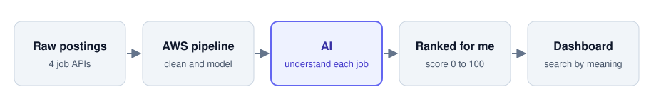
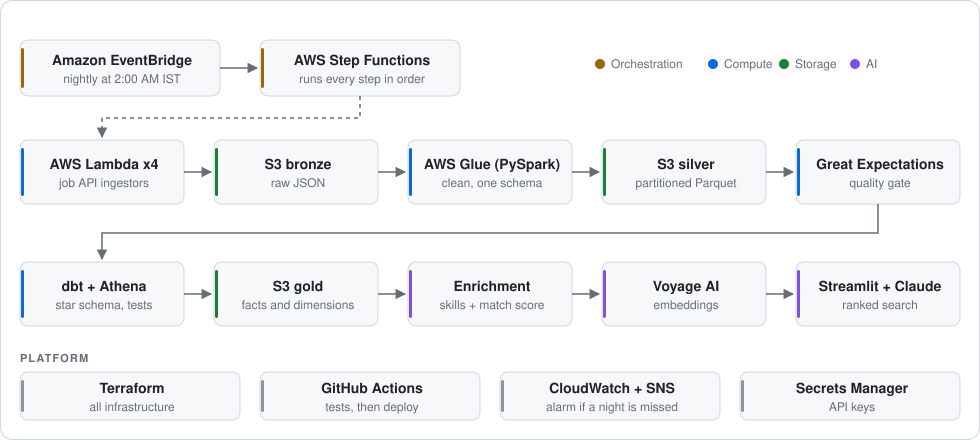

# JobPulse

[](https://github.com/malikvarun216-dot/jobpulse/actions/workflows/ci.yml)

**Every night, JobPulse reads about 6,000 new job postings and tells me which ones are worth my time.**

It pulls raw postings from four job APIs, cleans and models them on AWS, uses AI to understand each job
description, and ranks every job against my skills and experience. In the morning I open one dashboard: the best
matches are at the top, and I can search by meaning, like *"streaming data platform at a startup"*, not just by
keywords.

<picture>
  <source media="(prefers-color-scheme: dark)" srcset="docs/images/pipeline-dark.svg">
  
</picture>

## What it answers

| Question | How |
|---|---|
| How many openings per role / country / source? | Star schema in Athena, dashboard filters |
| Which skills and companies show up most? | Tag frequency, company leaderboard |
| Which jobs are worth applying to? | Personal `match_score` (0 to 100) |
| Which jobs *mean* what I'm looking for, even with different words? | Embedding-based semantic search |

## How it works

1. **Collect.** Serverless functions pull postings from Greenhouse, Adzuna, Arbeitnow and Remotive every night at 2 AM.
2. **Clean.** Spark turns four different formats into one table, and quality checks stop bad data before it goes further.
3. **Model.** dbt builds a star schema on S3 that can be queried with SQL in Athena.
4. **Understand.** Skills and seniority are extracted from each description, and each description becomes an
   embedding, a numeric representation of its meaning, so similar jobs can be found even when the words differ.
5. **Rank.** Every job gets a match score from 0 to 100 against my profile, and Claude explains why the top jobs match.

| 6,000 | 10 min | 255 | 0 |
|:---:|:---:|:---:|:---:|
| jobs every night | end to end | automated tests | servers to manage |

## Built to run on its own

The whole pipeline runs unattended on AWS: Lambda, Step Functions, Glue, S3 and Athena, all defined in Terraform
and deployed by GitHub Actions. If a night is missed, an alarm emails me.

It has also been through real failures. One nightly step slowly grew to an hour and then started timing out. It
looked like a volume problem, but every AI call had been failing quietly and waiting in retries. Fixing the root
cause took that step from **56 minutes to 4 seconds**. That story and others are in [docs/incidents.md](docs/incidents.md).

## Architecture

<picture>
  <source media="(prefers-color-scheme: dark)" srcset="docs/images/architecture-dark.svg">
  
</picture>

## What's next

Measuring search quality with a labelled evaluation set, then improving it with hybrid keyword and vector search
and comparing two vector databases (pgvector and Amazon S3 Vectors). Each change has to improve the measured
numbers. Plan in [docs/roadmap.md](docs/roadmap.md).

**Stack:** Python, PySpark, SQL, dbt, AWS (Lambda, Step Functions, Glue, S3, Athena), Great Expectations,
Terraform, GitHub Actions, Claude API, Voyage AI, Streamlit.

**More detail:** [design decisions](docs/decisions.md) · [incidents](docs/incidents.md) · [runbook](docs/runbook.md) · [progress log](docs/progress.md)

<details>
<summary><b>Run it locally</b></summary>

Install dependencies and run the tests (same as CI):

```powershell
pip install -r requirements.txt
```

```powershell
pytest tests/ spark/tests/ -v
```

Infrastructure is in `terraform/envs/dev/`. Secrets come from environment variables, not committed files:

```powershell
$env:TF_VAR_adzuna_app_id = "<id>"; $env:TF_VAR_adzuna_app_key = "<key>"
```

Start the dashboard against AWS:

```powershell
streamlit run dashboard/streamlit/app.py
```

</details>
